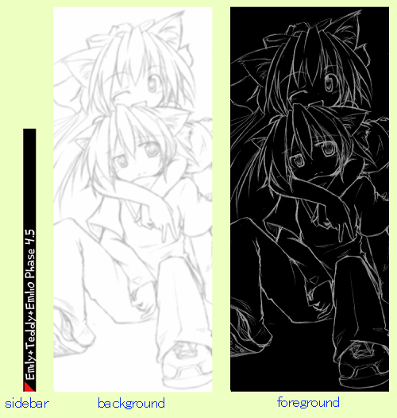
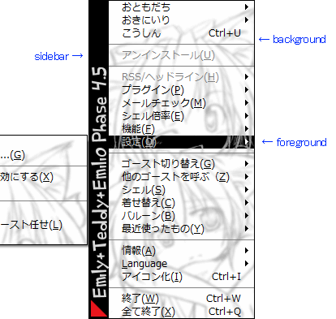

# オーナードローメニューの設定

オーナードローメニュー（右クリックメニュー）の表示を設定する方法について解説します。

ファイル構成の「[オーナードローメニュー](../manual/owner-draw-menu.md)」もあわせて参考にしてください。

設定は、シェルの`descript.txt`に記載するか、リソース取得用に発行されるいくつかのSHIORI Eventに対するレスポンスとして設定します。

## 目次

1. [シェルのdescript.txtで設定する](ownerdraw.md#シェルのdescripttxtで設定する)
2. [SHIORI Eventで設定する](ownerdraw.md#shiori-eventで設定する)

## シェルのdescript.txtで設定する

シェルの`descript.txt`で設定できるのは通常時・選択中の背景およびサイドバーとして使われる３枚の画像と、文字色です。

SSPのみ、文字サイズおよびフォントの指定も可能です。

また着せ替えメニューの項目の配置などもシェルの`descript.txt`で行いますが、これについては「[着せ替えの設定](bind.md)」のページを参照してください。

なお、同じ項目についてSHIORI Eventを利用する方法でも同時に設定されている場合、SHIORI Eventによる設定が優先されますので注意してください。

以下が`descript.txt`による記述の例です。

```
menu.background.bitmap.filename,background.png
menu.foreground.bitmap.filename,foreground.png
menu.sidebar.bitmap.filename,sidebar.png

menu.background.alignment,lefttop
menu.foreground.alignment,lefttop
menu.sidebar.alignment,bottom

menu.background.font.color.r,0
menu.background.font.color.g,0
menu.background.font.color.b,0
menu.foreground.font.color.r,0
menu.foreground.font.color.g,0
menu.foreground.font.color.b,255
menu.separator.color.r,0
menu.separator.color.g,0
menu.separator.color.b,0
menu.disable.font.color.120
menu.disable.font.color.120
menu.disable.font.color.120
```

各行の詳細は、「[Shell設定](../descript/shell/descript-txt/menu.font.name.md)」にありますが、以下大まかに説明します。

```
menu.background.bitmap.filename,background.png
menu.foreground.bitmap.filename,foreground.png
menu.sidebar.bitmap.filename,sidebar.png
```

上記三行は、オーナードローメニューに使われる3種類の画像それぞれについての設定です。

backgroundは、通常時のメニュー背景です。

foregroundは、選択されている項目の背景画像です。少しわかり難いですが、オーナードローメニューの現在カーソルが載っている部分だけ、foreground画像のその位置の部分でbackground画像から置き換わります。

sidebarは、オーナードローメニューの左側に付属する画像です。

[](../assets/image/ownerdraw_materials.png)

[](../assets/image/ownerdraw_view.png)

*上が使われる3つの画像、下が実際の表示（例:Emily/Phase4.5）*

```
menu.background.alignment,lefttop
menu.foreground.alignment,lefttop
menu.sidebar.alignment,bottom
```

上記三行は、3種類の画像それぞれの配置についての設定です。

background、foregroundの画像は上例の場合左上を起点に配置され、もしメニューの文字数や項目数の関係で、メニューが背景画像よりも大きくなる時、はみ出す領域の右側及び下側は、それぞれ画像の右端と左端の色が延長されて表示されます。

```
menu.background.font.color.r,0
menu.background.font.color.g,0
menu.background.font.color.b,0
menu.foreground.font.color.r,0
menu.foreground.font.color.g,0
menu.foreground.font.color.b,255
menu.separator.color.r,0
menu.separator.color.g,0
menu.separator.color.b,0
menu.disable.font.color.120
menu.disable.font.color.120
menu.disable.font.color.120
```

上記は文字色の設定です。

backgroundは通常時のメニュー文字色、foregroundは項目にカーソルが載っている時の文字色、separatorはメニューの区切り字の色、disableは例えば着せ替えがないシェルでの着せ替えメニューやネットワーク更新に非対応なゴーストでのネットワーク更新の項目など、非アクティブな項目の文字色です。

RGBカラーのそれぞれの色要素について、0～255の数値で指定します。rgb全てが255なら白、全てが0なら黒になります。

## SHIORI Eventで設定する

シェル側`descript.txt`による設定と同様の設定に加え、メニュー各項目の表示名や、お気に入り・ポータルのリンク集について内容の設定が可能です。

なお、同じ項目についてシェル側`descript.txt`に設定があったとしても、SHIORI Eventによる設定が優先されます。

メニューに関するリソースを取得するためのSHIORI Eventに対して、どのように値を設定し・返却するかは各SHIORIの解説を参照する必要があります。

例えば里々の場合は以下のページが参考になるでしょう。

[里々wiki - 右クリックメニュー](http://soliton.sub.jp/satori/index.php?%B1%A6%A5%AF%A5%EA%A5%C3%A5%AF%A5%E1%A5%CB%A5%E5%A1%BC)

その他どのようなSHIORI Eventがあるかについては「[SHIORI Resource](../list/shiori-resource/ownerdraw-image/menu.sidebar.bitmap.filename.md)」のページを参照してください。
