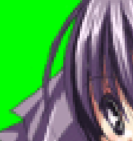
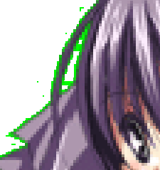
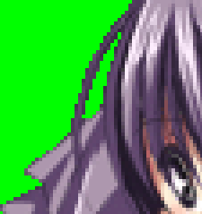
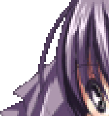

# シェルの作成

ここでは基本的なシェルの作成手順について解説しています。

ただし設定ファイルの記述についてが中心で、作画や画像の加工などについてはほとんど触れていませんのでご了承ください。

ファイル構成の[シェル](../manual/shell.md)も参照してください。

## 目次

1. [立ち絵となる画像を用意する](shell.md#立ち絵となる画像を用意する)

2. [descript.txtを書く](shell.md#descripttxtを書く)

3. [surfaces.txtを書く](shell.md#surfacestxtを書く)

   1. [surfaces.txtを書く - 当たり判定編](shell.md#surfacestxtを書く---当たり判定編)
   2. [surfaces.txtを書く - アニメーション編](shell.md#surfacestxtを書く---アニメーション編)
   3. [surfaces.txtを書く - element合成編](shell.md#surfacestxtを書く---element合成編)

4. [readme.txtを書く](shell.md#readmetxtを書く)

1. [半透明のサーフェスについて](shell.md#半透明のサーフェスについて)
2. [追加シェルのネットワーク更新について](shell.md#追加シェルのネットワーク更新について)
3. [着せ替えについて](shell.md#着せ替えについて)
4. [複数のサーフェスで共通の設定をまとめる](shell.md#複数のサーフェスで共通の設定をまとめる)
5. [オーナードローメニューの設定](shell.md#オーナードローメニューを設定する)
6. [サムネイル画像の設定](shell.md#サムネイル画像を設定する)

## 立ち絵となる画像を用意する

まずは立ち絵とする画像を用意します。

自分で絵を描くか、フリーシェルと呼ばれる配布されている既成シェルを使用するなどします。

!!! tip "ヒント"

    フリーシェルは以下のようなサイトから探す事ができます。

    [freeshell wiki](http://wikiwiki.jp/feeshell/)

ゴーストにおける画像形式の基本はpngです。

jpg、bmp等は使えません（SSPでは可）。

pngを使用していれば大きさ、色数に制限はありませんが、透明度は基本的に無効です（SSPのみ設定次第で有効。後述の[半透明のサーフェスについて](shell.md#半透明のサーフェスについて)参照）。

ファイルサイズを小さくしたい場合は何らかのツールで減色してください。

シェルを構成する立ち絵の一枚一枚や、後述のアニメーションの一コマは、*サーフェス*と言う単位で管理されます。

サーフェスは、「surface○○.png」（○○部分には0以上の数字が入る）という名前の画像を用意するか、[後述のsurfaces.txt](shell.md#surfacestxtを書く)で複数の画像を合成する事で用意します。

`surface0.png`と`surface10.png`の二つの画像は基本的に必須です。

`surface0.png`はメイン側の基本サーフェス、`surface10.png`は相方側の基本サーフェスとなります。

ゴーストとしてキャラクターが一人だけで相方が要らない場合でも、単色で塗り潰した画像(＝全て透明表示。後述)などを`surface10.png`として用意してください。

サーフェスは`surface0000.png`、`surface0010.png`等の様に記述しても`surface0.png`、`surface10.png`と同様に認識されます。

サーフェス画像では左上端の1ドットが「透過色」としてゴーストとしての表示上透過されます。

透過色と同じ色がキャラクター内にもあった場合、その部分も透過されてしまいますので、透過色にはキャラクターに使っていない系統の色を用いるなどしてください。

サーフェスとして用いる画像を自分で用意する場合、注意すべき特徴として輪郭の処理があります。

|  | → |  |
| --- | --- | --- |

キャラクターの輪郭が半透明になって背景と混ざった結果、右のように表示されてしまいます。

|  | → |  |
| --- | --- | --- |

この様に輪郭が背景と混ざらないようにすると綺麗に色が抜けます。

!!! tip "ヒント"

    Photoshopをして作成する場合、[ClearBrain Systems](http://homepage3.nifty.com/khsoft/cbs/)（[アーカイブ](https://web.archive.org/web/20100714191818/http://homepage3.nifty.com/khsoft/cbs/)）の[シェル＆縮小サーフェス制作補助プラグインセット for Photoshop](http://homepage3.nifty.com/khsoft/cbs/software/)（[アーカイブ](https://web.archive.org/web/20070103182224/http://homepage3.nifty.com/khsoft/cbs/software/)）を使うと効率よく作業ができると思います。

    また輪郭を識別して「ふち」をつけてくれる「[ふちどり](http://ukiya.sakura.ne.jp/index.php?%E8%87%AA%E4%BD%9C%E3%82%BD%E3%83%95%E3%83%88%E4%B8%80%E8%A6%A7%2F%E3%81%B5%E3%81%A1%E3%81%A9%E3%82%8A%E3%80%82)（[アーカイブ](https://web.archive.org/web/20251119211223/http://ukiya.sakura.ne.jp/index.php?%E8%87%AA%E4%BD%9C%E3%82%BD%E3%83%95%E3%83%88%E4%B8%80%E8%A6%A7%2F%E3%81%B5%E3%81%A1%E3%81%A9%E3%82%8A%E3%80%82)）」というツールが公開されています。

## descript.txtを書く

`descript.txt`は、そのシェルの基本的な情報を設定するためのファイルです。

`descript.txt`が適切に用意されていないと、シェルがゴーストに認識してもらえません。

とりあえずは以下の内容をコピーして`descript.txt`という名前のテキストに貼り付け、自分のシェルに適切な内容へ書き替えましょう。

```
charset,Shift_JIS
type,shell
name,このシェルの名前

craftman,制作者名(英数のみで書いてください)
craftmanw,制作者名(日本語表記でも可能)
craftmanurl,制作者のURL(配布サイトurlなど)
```

charsetは基本的にShift_JISにしておいてください。

他にも色々設定できる項目はありますが、最低限必要なのは上記ぐらいです（厳密にはnameとtypeだけ必須）。

ここで取り上げていない設定や、各設定のより詳細な説明などは、「[Shell設定](../descript/shell/index.md)」のページを参照してください。

例として一つだけあげると、シェル全体の基本バルーン位置を変えるには

```
sakura.balloon.offsetx,0
sakura.balloon.offsety,0
kero.balloon.offsetx,0
kero.balloon.offsety,0
```

といった項目を書き足す事になります。

sakura.balloon.offsetがメイン側、kero.balloon.offsetが相方側のバルーン位置の変更になります。

数字を増やすとx座標はキャラクター寄りにy座標は下に表示されます。

マイナスをつけると表示位置が逆の方向になり、x座標はキャラクターから離れ、y座標は上に表示されるようになります。

着せ替えをメニューに表示する場合も`descript.txt`への記述が必要ですが、そのあたりについての説明は[着せ替えの設定](bind.md)のページをご覧ください。

## surfaces.txtを書く

まずは`surfaces.txt`という名前のテキストを作ります。

これはアニメーションの設定や、画像の合成、マウスカーソルでキャラクターを操作する時の当たり判定の設定などを行うファイルです。

「[Shell設定 - surfaces.txt](../descript/shell-surfaces/index.md)」のページも合わせて参照してください。

`surfaces.txt`を作ったら、まずは先頭に以下をコピーして下さい。

```
charset,Shift_JIS

descript
{
version,1
}
```

先頭の一行は`descript.txt`のものと同じ文字コードの指定です。特に理由がなければShift_JISで構いません。

それより下の記述は、アニメーションの設定方法の書式についてのの設定です。

もしこの記述が無い場合は、アニメーション関係を旧来の定義（SERIKO/1.x）で書かねばなりません。

このページで以下登場する例は、新しい定義（SERIKO/2.0）によるものなので、注意してください。

!!! tip "ヒント"

    既に旧定義で書かれているsurfaces.txtは、以下のツールを用いて旧定義から新定義に変換する事が可能です。

    - [サクラエディタ用マクロ「SERIKO1to2.js」](http://gallnuts.webcrow.jp/etc/etc.shtml)（[アーカイブ](https://web.archive.org/web/20160621201301/http://gallnuts.webcrow.jp/etc/etc.shtml)）

      使用方法：[サクラエディタ](http://sakura-editor.sourceforge.net/)を導入し、マクロとして使用します。詳細は付属のreadme.txt。

    - [surfaces.txtを旧定義から新定義に変換するツール](http://typehoon.kusakage.com/zip/SurfacesTxtConverter.zip)

      使用方法：解凍された.exeをsurfaces.txtと同じフォルダで実行して下さい。

### surfaces.txtを書く - 当たり判定編

サーフェスに当たり判定を定義することから始めてみましょう。

最初に、以下を`surfaces.txt`に追記してください。

```
surface0
{
}
```

これは、このブレス（\{\}中括弧）の中で、surface0について設定する、と言うような意味になります。

当たり判定に限らず、後に触れるアニメーションやelementの設定もこの中に書いて行きます。

ここに以下のように書くと、当たり判定の定義になります。

```
surface0
{
collision0,117,71,185,130,Face
collision1,115,174,174,217,Bust
}
```

上のように当たり判定１箇所ごとにcollision0、collision1、collision2と順番に書いていきます。

番号は一つのサーフェス内で重複しないようにしてください。

1サーフェス辺りのcollision最大個数は256個です。

それに続く4つの数字は座標指定です。

サーフェス画像自体の左上を0,0として、四角形の左上x,y座標、右下のx,y座標と言う並びになっています。

最後の文字列はゴースト側で用いる当たり判定の名前になります。

なお、同じ名前（上例のFace、Bust）の当り判定を複数回設定しても構いません（例えば手をHandという名前の当たり判定にしたいとき、多くの場合右手と左手で領域が分かれるはずなので、Handを指定する行も2行に分かれるでしょう）。

!!! tip "ヒント"

    当たり判定の座標の取得には[Coordin](http://ukgk.s34.xrea.com/poskoma/#content_1_11)というツールが便利です。

    Coordinに画像をドロップしドラッグで四角い当たり判定を作ります。

    自動的にクリップボードに座標がコピーされているので当たり判定の数字に貼り付けてください。

!!! tip "ヒント"

    MATERIAの場合、設定で開発インターフェイスにチェックするとオーナードローメニューから当たり判定領域を確認できるようになります。

    SSPの場合、設定→本体設定の「一般」で開発者機能をオンにして、機能→開発用パレットを開き、当たり判定を表示で確認できます。

### surfaces.txtを書く - アニメーション編

伺かにおけるアニメーション（SERIKOと呼ばれます）は、静止画を連続で描画する事で表現されます。

ここではアニメーションの実行タイミング、一枚一枚の静止画の重なり方等の設定方法について簡単に紹介します。

以下surface0をまばたきをさせる例でアニメーションを説明します。

```
surface0
{
animation0.interval,sometimes
animation0.pattern0,overlayfast,100,50,0,0
animation0.pattern1,overlayfast,101,50,0,0
animation0.pattern2,overlayfast,100,50,0,0
animation0.pattern3,overlay,-1,100,0,0

collision0,117,71,185,130,Face
collision1,115,174,174,217,Bust
}
```

surface0.pngにアニメーションさせるにはこのようにsurface0と書き、その下のブレス（\{\}中括弧）内にアニメーションの内容を定義していきます。

```
animation0.interval,sometimes
```

animation\*,intervalという行は、その番号のアニメーションが実行されるタイミングの定義です。

「animation」に続く数字は、そのアニメーション定義（タイミングの設定であるintervalと、後に続く「コマ」の設定であるpatternなどのセット）のIDになります。

アニメーションIDは自由な番号でよく、連番である必要もありませんが、*同じ意味のアニメーションについて同じID*が与えられることが期待されます[※](shell.md#surfacestxtを書く---アニメーション編)。

animation0.interval,に続く「sometimes」がインターバル定義の内容です。

例のようにsometimesを指定した場合、そのアニメーションは時々（１秒当たり２分の１の確率）勝手に実行されます。

つまり「IDが0番のアニメーションは時々勝手に動く」といった指定をしている事になります。

他にどんなタイミング指定があるかについては、「Shell設定 - surfaces.txt」の[アニメーションインターバルについての節](../descript/shell-surfaces/surface-brace/h-animationinterval/sometimes.md)をご覧ください。

続けてアニメーションを構成する静止画（コマ）一枚一枚の定義を行います。

それぞれpattern0、pattern1、pattern2というように順番に書いていきます。パターン番号の抜け・重複はできません。

先頭に同じアニメーション群のID（animation\*）を入れるのを忘れないでください。

また、interval定義行と一連のpattern定義行は別々の場所に分けて書いたりせずに、連続して書くようにしてください。

```
animation0.pattern0,overlay,100,50,0,0
```

overlayの部分は描画方法の指定です。

overlayとは元の画像の上に重ねて画像を表示する描画方法です。

この他にも様々な描画方法が用意されています。

詳しくは「Shell設定 - surfaces.txt」の[サーフェス描画メソッドについての節](../descript/shell-surfaces/surface-brace/h-drowmethod/base.md)をご覧ください。

```
animation0.pattern0,overlayfast,100,50,0,0
```

100という部分は、このコマで描画するのはsurface100だという意味です。

基本的には`surface100.png`のことだと考えてよいです。

101とすれば`surface101.png`の画像が用いられます。

-1とすると、そのアニメーションの描画を停止してベース画像（上例の場合はsurface0）の表示にリセットされます。

```
animation0.pattern0,overlayfast,100,50,0,0
```

50の部分は表示時間（単位:ミリ秒）です。

そのコマに*切り替わるまでの時間*を指定してください。

そのコマ自身の表示時間ではないので注意しましょう。

```
animation0.pattern0,overlayfast,100,50,0,0
```

最後の0,0の部分はコマの表示位置です（x座標,y座標）。

元の画像からどれだけずらして表示するか指定します。

x方向は右が正、y方向は下が正です。

!!! note "注"

    #### [※1](shell.md#surfacestxtを書く---アニメーション編)

    例えばキャラクターに正面向きのポーズのsurface0と横向きのポーズのsurface5があったとして、その両方で「まばたき」アニメーションをしたいとします。

    この時、上例のようにsurface0で瞬き定義をする他に、surface5でも同じような定義をすることになりますが、横向きと正面向きという違いがあるために、コマとして用いるサーフェス（画像）は異なるはずです。

    しかし、両方同じように扱われる「まばたき」ではあるので、同じアニメーションID（例えば0）にする事が望ましいでしょう。

    このルールは特に、別項で説明する「[着せ替え](bind.md)」の場合においては必須となります。

### surfaces.txtを書く - element合成編

elementは、複数のパーツ画像を合成して1枚のサーフェスとして扱うための仕組みです。

例えば、全てのサーフェスを必ずsurface0.pngといった画像として用意しなければならないなら、キャラクターの表情を増やす場合には、例え口の形が少し違うだけであっても、表情の数だけ全身の立ち絵を用意する必要があります。

しかし、身体パーツと表情パーツを分け、それを合成する事ができるならば、表情を増やす場合にも、画像としては表情差分だけ用意すればよくなるので、シェル全体の容量はずいぶん減るでしょう。

さらにもし目元と口元のパーツを分ければ、目と口の組み合わせで様々な表情になるので、実際にその表情自体を作画することなしに、ある程度の表情を作り出すことさえできます。

以下がelement定義の記述例となります。

```
surface1
{
element0,overlay,body0.png,0,0
element1,overlay,face1.png,0,0
}
```

これで、「body0.png」の上に「face1.png」を重ねたものがsurface1として定義されます。

重ねたいパーツの数だけいくつでも書き足して行く事ができます。

なおこの場合surface1.pngは不要です。

```
element0,overlay,body0.png,0,0
```

「element」のすぐ後に続く数字は、そのサーフェスにおけるelementのID（通し番号）です。

IDは0から始まる連番です。数字が小さい方が、より下（画面奥側）に合成されるパーツになります。

なお、surface\*.pngのような名前のpng画像は、element0より下のパーツとみなされる点に注意してください。

```
element0,overlay,body0.png,0,0
```

続くキーワードは描画メソッドです。

基本的に[アニメーションのものと同じ](../descript/shell-surfaces/surface-brace/h-drowmethod/base.md)ですが、startやmoveなど、純粋に画像を合成するのでない一部のメソッドは使用できません。

```
element0,overlay,body0.png,0,0
```

続けて合成するファイル名を指定します。

任意名のpngファイルが指定可能です。

```
element0,overlay,body0.png,0,0
```

最後の二つの数字は合成位置の指定です（x座標,y座標）。

ベース画像に対してどれだけずらして合成するかを指定します。

x方向は右が正、y方向は下が正です。

ところで今回の例では、先述の[当たり判定](shell.md#surfacestxtを書く---当たり判定編)や[アニメーション](shell.md#surfacestxtを書く---アニメーション編)の例の時と違って、surface0ではなくsurface1にelementの定義しています。

あくまで例示についての話ではありますが、これには一応理由があります[※](shell.md#surfacestxtを書く---element合成編)。

シェル（ゴースト）そのものの動作だけ考える時には、surface0や10でelementを用いる事にはまったく問題はありません。

!!! note "注"

    #### [※2](shell.md#surfacestxtを書く---element合成編)

    例えばゴーストのデータベースのようなWebサービスなどで、ゴーストのプレビューを表示したい場合を考えます。

    [先にも述べた通り](shell.md#立ち絵となる画像を用意する)、surface0とsurface10は基本サーフェスとされ、基本的に省略できません。

    つまりsurface0と10は必ずあるものと考えられますから、プレビューに用いるのには都合が良いでしょう。

    しかし、もしsurface0や10がelement合成によって構成されていると、プレビュー表示者はelement定義を読み取って意図どおりに合成する必要が出てきてしまいます。

    これは人力はもとよりプログラムで自動化するシステムにおいてもいくらかの障壁になります。

    従って、そうしたサービスの利用を視野に入れる場合には、surface0と10は実体のpngとして用意した方がよいかもしれません。

    なお、こうしたプレビュー表示を行っているサービスとして、更新フィード「[SiReFaSo](https://sirefaso.appspot.com/)（[アーカイブ](https://web.archive.org/web/20170423052451/https://sirefaso.appspot.com/)）」があげられます。

## readme.txtを書く

`readme.txt`というファイルがあるとオーナードローメニューやインストール時などに表示できます。

省略できますが、ゴーストの作者とシェル作者が異なる場合などは、連絡先を明記した方がよいかもしれません。

シェルの説明や連絡事項など必要な事を記入してください。

readmeも他のファイル同様、1行目にcharset,UTF-8などと書いておくか、BOMを含んでおけばShift JIS以外も使えます。

## 半透明のサーフェスについて

半透明にするには半透明にしたい画像と同じファイル名の「pna」を作ります。

例えば`surface0.png`に対して`surface0.pna`となります。

SSPの場合、[element合成](shell.md#surfacestxtを書く---element合成編)のパーツにも用意できます。`face1.png`に対して`face1.pna`といった具合です。

pnaは透明度をグレースケールで表したpngを単にリネームしたものです。

pnaで完全に白くした部分が不透明、完全に黒くした部分が透明となり、その中間が半透明となります。

|  | → |  | → |  |
| --- | --- | --- | --- | --- |
| surface0.png |  | surface0.pna |  | デスクトップの表示 |

半透明の部分はキャラクターとしてクリックできます。

ですので透明部分は完全な黒(RGBが0,0,0)色にしてください。

またSSPの場合、pnaを用いずに、`surface*.png`画像をアルファチャンネル付きPNGとして作成し、そのアルファチャンネルを透明度として利用する事ができます。

その場合、`descript.txt`に以下の記述を追加する必要があります。

```
seriko.use_self_alpha,1
```

なおアルファチャンネル付きPNGの作成方法自体は各種ペイントソフトなどの説明を参照してください（ソフトによっては扱えないこともあります。透明度付きPNG、32bitPNG、αPNGなどのキーワードでも検索してみてください）。

## 追加シェルのネットワーク更新について

SSPでは、シェル自体にネットワーク更新機能をつける事ができます。

詳しくは「[ネットワーク更新への対応](update.md)」のページをお読みください。

## 着せ替えについて

伺かでは、着せ替えはアニメーションの一種として設定されます。

詳しくは「[着せ替えの設定](bind.md)」のページをお読みください。

## 複数のサーフェスで共通の設定をまとめる

例えばキャラクターの姿勢が同じサーフェスがいくつもある場合、当たり判定やアニメーション指定なども全く同じというサーフェスが存在するかもしれません。

そうした場合、それぞれのsurfaceのブレスに何度も同じ設定をコピペする以外にも、便利な記述方法がいくつかあります。

ただし、そのうちのほとんどは*SSP限定*の方法です。

詳細は「Shell設定 - surfaces.txt」のページ内の「[surface\*ブレスで可能なID指定](../descript/shell-surfaces/surface-brace/caption_surfacebraceid.md)」をご覧ください。

## オーナードローメニューを設定する

オーナードローメニュー（右クリックメニュー）の背景画像や文字色なども、シェルで設定できます。

詳しくは「[オーナードローメニューの設定](ownerdraw.md)」を参照してください。

## サムネイル画像を設定する

オーナードローメニューのシェル選択で、シェルにカーソルが乗った時にサムネイル画像を表示することができます。

シェルが複数あるなどして一目でわかりやすくしたい場合などに用意するとよいでしょう。

`thumbnail.png`という画像が同じフォルダに入っていれば自動的に使用されます。
