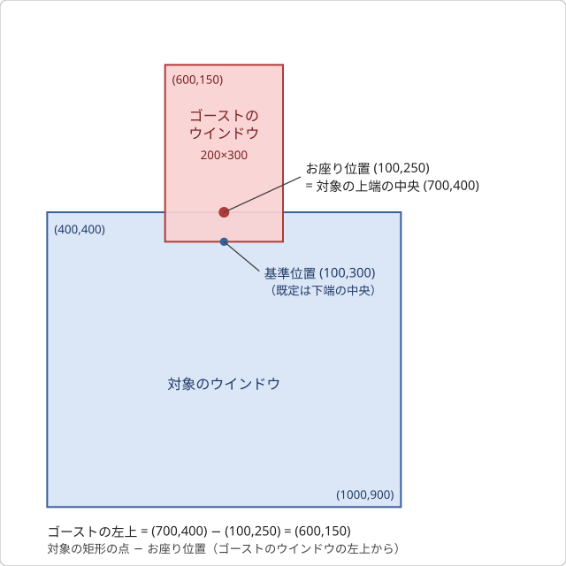
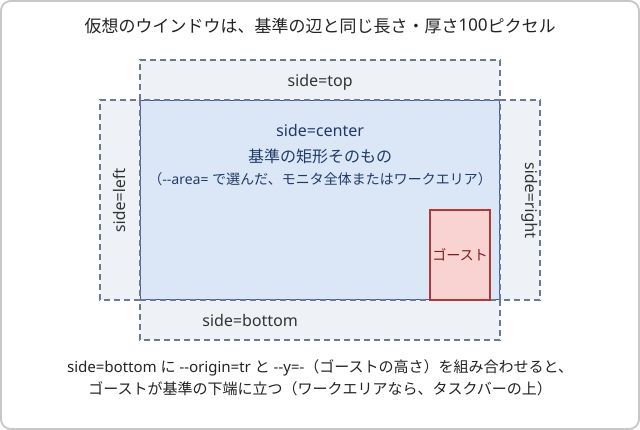
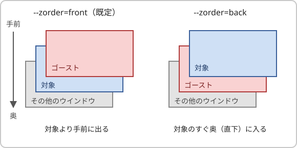

# `\![set,alignmenttodesktop,方向]`

**カテゴリ:** サーフェスコマンド

現スコープ側サーフェスをデスクトップの指定した方向に吸着。方向は以下の方法が指定可能。

- **top**: 上部に吸着。
- **bottom**: 下部に吸着。
- **left**: 左部に吸着。
- **right**: 右部に吸着。
- **free**: 吸着なし。
- **osuwari**: \[SSP 2.9.33\] 他のウインドウ（前面のウインドウ・指定したウインドウ）や画面の矩形に追尾する（後述）。
- **default**: ゴーストのデフォルト設定に戻す。

上または下に吸着した場合、上下方向へのドラッグ移動ができなくなる。<br />
左または右に吸着した場合、左右方向へのドラッグ移動ができなくなる。

ゴースト終了まで有効。

※上記はalignment*on*desktopと書いても有効。

**対応:** SSP / Ninix

## osuwari（お座り） \[SSP 2.9.33\]

`\![set,alignmenttodesktop,osuwari,オプション,…]`

ゴーストのウインドウを、他のウインドウの隅に「座らせる」「貼り付ける」「ぶら下げる」。ukiya氏のSAORI「Osuwari.dll」と同じ処理をSSPが内蔵したもので、オプションもそれに対応する。シェルの`descript.txt`に`seriko.alignmenttodesktop,free`を書く必要はない（`osuwari`を指定すると、それ自体がアラインの指定になる）。

### 考え方（ゴーストのウインドウと他のウインドウの関係）

osuwariは、一定の間隔で、次のことを繰り返している。

> ゴーストのウインドウの左上を、画面のどこに置くか。

答えは、「どのウインドウの」「どの点に」「ゴーストのウインドウのどの点を」「何ピクセルずらして」合わせるか、で決まる。登場するものは次のとおり。

- **ゴーストのウインドウ**: キャラクター（`\0`・`\1`…）ごとのウインドウ。大きさは今表示しているサーフェスの画像と同じで、透明な部分も含む。位置は左上の座標で表す。サーフェスが変わって大きさが変わると、右端・下端・中央の位置も変わる。
- **対象**: ゴーストが座る相手のウインドウ。見た目の枠で測る（影などの見えない枠は含まない）。
- **基準の矩形**: 対象に座れないとき・座ると画面からはみ出すときに、対象の代わりに座る矩形。対象のあるモニタの全体またはワークエリアで、`--area=`と`--side=`で決める。
- **原点**: 「対象の矩形のどの点に、ゴーストのウインドウのどの点を合わせるか」の組。`--origin=`で決める。
- **ずれ**: 合わせた位置からのずれ。`--x=`と`--y=`で決める（右・下が正）。

位置は、X軸・Y軸それぞれ次の式で求める。

```
ゴーストのウインドウの左上 = 対象の矩形の点 − ゴーストのウインドウの点 + ずれ
```

「点」は`--origin=`が決める。座る相手が対象のときは対象の矩形、座れないときは基準の矩形である。

決めることとオプションの対応は次のとおり。

| 決めること | オプション |
|---|---|
| どのウインドウに座るか | `--target=` |
| 対象のどの点に、ゴーストのどの点を合わせるか | `--origin=` |
| そこからどれだけずらすか | `--x=` `--y=` |
| 座れないとき・はみ出すとき、どこへ座るか | `--area=` `--side=` `--margin=` `--noclip` |
| ドラッグで動かせる範囲 | `--xmove` `--ymove` |
| 対象より手前か、奥か | `--zorder=` |
| どのくらいの間隔で追うか | `--interval=` |

### 位置の決まり方

`--interval=`の間隔ごとに、次の順で位置を決める。ただし、対象・対象の矩形・ゴーストのウインドウの矩形・サーフェスの基準位置とお座り位置のどれも前回から変わっていなければ、求め直さない。

1. 対象を探す（`--target=`）。
   - `active`: 前面のウインドウ。座れないウインドウ（下記）が前面のときは、直前に座れたウインドウ。まだ座れたウインドウが無ければ、対象なし。
   - `@文字列`: タイトルに文字列を含むウインドウのうち、座れるもの。複数あれば、Zオーダーで手前にあるもの。
   - `#数値`: ウインドウハンドルが数値（10進）のウインドウ。座れなければ、対象なし。
   - `fix`: 常に対象なし。
2. 座る相手の矩形を決める。対象があって座れるときは対象の矩形。対象なしのときは基準の矩形（`--area=`と`--side=`）。
3. `--origin=`で選んだ2つの点を重ねて、ゴーストのウインドウの左上を求める。そこへ`--x=`と`--y=`を足す。
4. `--xmove`・`--ymove`を指定した方向は、座る相手の矩形が前回と同じなら、ゴーストのウインドウの今の位置（ドラッグで動かした位置）を相手の内側へ収めて、ずれとして採用する（[ドラッグで動かせる範囲](bang-set-alignmenttodesktop.md#ドラッグで動かせる範囲)）。
5. ゴーストのウインドウが画面からはみ出していないかを調べる（見切れ判定）。はみ出していれば、2の相手を基準の矩形に替えて、3〜4をもう一度だけやり直す。やり直したあとは調べない。`--target=fix`・`--noclip`・対象なしのときは、調べない。
6. 求めた位置へゴーストのウインドウを動かし、前後関係（`--zorder=`）を整える。

3の点の選び方とずれは、5のやり直しでも同じ値を使う。変わるのは、座る相手の矩形だけである。

### オプション

オプションは`--名前=値`の形で、すべて省略できる。省略したオプションは、前回の呼び出しで指定した値ではなく、既定値になる。解釈できないオプションは無視する。

| オプション | 既定 | 内容 |
|---|---|---|
| `--target=` | `active` | 追尾する対象。`active`: 前面のウインドウ / `fix`: 画面（ワークエリア）に固定 / `@文字列`: ウインドウタイトルに文字列を含む（大文字小文字は区別しない）ウインドウ / `#数値`: ウインドウハンドルが数値のウインドウ |
| `--origin=` | `osuwari` | ゴーストのウインドウのどの点を、対象に合わせるか（原点）。`左右.上下`の形で書く（下の「原点の書き方」）。`tl` `tr` `bl` `br`のように、隅を2文字で書くこともできる |
| `--x=` `--y=` | `0` | 原点からのずれ（ピクセル） |
| `--interval=` | `100` | 位置を調べる間隔（ミリ秒）。10未満は10 |
| `--xmove` `--ymove` | なし | その方向のドラッグ移動を許す（対象の矩形の内側まで）。指定しない方向は、ドラッグしても座る位置へ戻る。`--xmove=false`のようにも書ける |
| `--noclip` | なし | 見切れ判定をしない |
| `--area=` | `workarea` | 座れないとき・見切れのときの基準。`desktop`: 画面全体 / `workarea`: ワークエリア（タスクバーなどを除いた部分） |
| `--side=` | `center` | 座れないとき・見切れのときの、基準に対する「仮想のウインドウ」の置き場所。`center`: 基準そのもの / `top` `left` `right` `bottom`: 基準の上・左・右・下側に厚さ100ピクセルの仮想のウインドウを置く |
| `--margin=` | `0_0_0_0` | 見切れ判定の余裕（ピクセル）。`左_上_右_下`の順で、空白か`_`で区切る。`0_50_0_100`なら、上へ50・下へ100ピクセルはみ出すまでは見切れとしない |
| `--zorder=` | `front` | 対象のウインドウとの前後関係。`front`: 対象の直上（手前）に表示する / `back`: 対象のすぐ奥（直下）に表示する。対象に座っていない間（座れないとき・`--target=fix`）は何もしない |

- `--origin=`と`--area=`の既定は、タグと`descript.txt`では`osuwari`と`workarea`。内蔵SAORIの`osuwari`（Osuwari.dll互換）は原作に合わせて`tl`と`desktop`のままである。\[SSP 2.9.34\] 2.9.33では、タグ・`descript.txt`も`tl`と`desktop`が既定だった。
- 対象に座れないとき（`--target=fix`、対象のウインドウが無いとき、前面のウインドウが座れないものであり、しかも直前に座れたウインドウも無いとき）と、見切れ（そのまま座ると画面からはみ出す）のときは、`--area`と`--side`で決まる基準の矩形を「仮想の対象」として座る。`--target=fix`では見切れ判定は行わない。
- ウインドウの矩形は、見た目の枠（Windows 10以降の見えない枠を含まない）で測る。基準とする画面は、対象のウインドウがあるモニタ（対象が無いときはゴーストのあるモニタ。ドラッグ中はカーソルのあるモニタ）。見切れは全モニタを合わせた領域で判定する。
- 最小化・非表示のウインドウ、別の仮想デスクトップのウインドウ、ダイアログなど所有されたウインドウ、SSP自身のウインドウ（`--target=active`のとき）には座れない。`--target=active`のときは、さらに明らかに座るべきでないシェルのウインドウ（デスクトップ、Alt+Tab・タスクビュー、スタート・検索・IMEパネルなどシェルが出すUWPのウインドウ、Windows 8のMetroの全画面ウインドウ）にも座れない。前面がそうしたウインドウのときは、直前に座れたウインドウに座り続ける。`@文字列`・`#数値`で自分で指定したウインドウは、この除外の対象にならない。
- 座っている間、ゴーストは対象のウインドウの上に表示される。osuwariがゴーストを最前面（常に他のウインドウより手前に出る状態）にするのは、対象が最前面のウインドウ（タスクバーなど）のときだけで、そうでなければゴーストは最前面にならない。ただし「常に手前に表示」の設定のゴーストは、その設定により、対象によらず最前面のまま。対象が最前面のウインドウのときも、ゴーストは対象の上に表示される（対象が前面に出るたびに、ゴーストも上へ戻る）。
- `--zorder=back`のときは、ゴーストは対象のウインドウのすぐ奥（Zオーダーで直下）に表示される。対象に隠れる位置から顔をのぞかせる、といった使い方ができる。間に他のアプリのウインドウが入っても、次の位置確認（`--interval=`の間隔）のときにすぐ奥へ戻る。対象が最前面のウインドウ（タスクバーなど）のときは、ゴーストも最前面になり、最前面のウインドウどうしの並びの中で、対象の直下に入る。「常に手前に表示」の設定のゴーストが、最前面でないウインドウの奥に座るときは、その設定を優先して最前面のままになる（奥の指定は効かない）。
- タスクバーの直上に座るだけ（ウインドウには追従しない）なら、`--target=fix`で画面に固定し、ワークエリアの下端を使う（例: `--target=fix,--origin=bl,--area=workarea,--side=center`。右端なら`--origin=br`）。ワークエリアはタスクバーなどを除いた部分なので、タスクバーが画面の下にあるときだけ、その直上に座ることになる。タスクバーが画面の上・左右にあるときは、画面の下端（ワークエリアの下端）に座る。タスクバーを自動的に隠す設定のときは、ワークエリアが画面全体になるので、画面の下端に座る。
- 他のアライン（`top` `bottom` `left` `right` `free`）を指定する、シェルを変更する、などでosuwariは止まる。`default`は、ゴーストのデフォルト設定（`descript.txt`。後述）へ戻す。ウインドウモードの間は止まり、通常のモードへ戻ると再開する。
- 座っている間の位置は、立ち位置として保存しない。
- sticky windowで連動している窓のうち、親でない側（連動の子）は、親に従うためosuwariを指定しても効かない。親が座ると子は一緒に動く。
- `\0`と`\1`はそれぞれ別に指定できる。ただし、ゴーストのウインドウの前後関係はゴースト単位でひとつなので、複数のキャラクターが座るときは、番号の小さい方の対象で決まる。

内蔵SAORIの`osuwari`（Osuwari.dll互換）も同じ処理を行う。ただし、SAORIの`START`は原作に合わせて、7つめ以降の引数を省略すると前回の値を引き継ぐ（[互換モジュール](../../../spec/saori-ex/compat.md)）。

### 原点の書き方 \[SSP 2.9.34\]

`--origin=`は、ゴーストのウインドウの上の点を、対象の矩形の上の点へ合わせる。`左右.上下`の形で、`.`の前がX軸、後ろがY軸。それぞれ次の語を書ける（大文字小文字は区別しない）。

| 語 | ゴーストのウインドウの点 | 対象の矩形の点 |
|---|---|---|
| `left`（Xのとき）/ `top`（Yのとき） | 左端 / 上端 | 左端 / 上端 |
| `right`（Xのとき）/ `bottom`（Yのとき） | 右端 / 下端 | 右端 / 下端 |
| `center` | 中央 | 中央 |
| `base` | サーフェスの基準位置（`point.basepos.x`・`point.basepos.y`。既定は足元の中央） | 中央 |
| `osuwari` | サーフェスのお座り位置（`point.osuwaripos.x`・`point.osuwaripos.y`。既定は`base`と同じ） | 中央 |

- `base`と`osuwari`は、`.`を付けずに1語だけ書くと、X軸・Y軸の両方になる（`--origin=osuwari`は`osuwari.osuwari`）。それ以外の語を1語だけ書くと、X軸だけの指定で、Y軸は`top`になる。
- `tl`は`left.top`、`tr`は`right.top`、`bl`は`left.bottom`、`br`は`right.bottom`と同じ。
- 解釈できない書き方は無視する（原点は変わらない）。
- 対象の矩形側に`base`と`osuwari`は無いので、中央を使う。たとえば既定の`--origin=osuwari`は、ゴーストの足元の中央（サーフェスの基準位置が既定のとき）が、対象の矩形の中央に来る。座る位置は`--x=`と`--y=`でずらす。
- 例: `--origin=center.bottom`は、ゴーストの中央（X）と下端（Y）を、対象の中央（X）と下端（Y）へ合わせる。`--origin=right.osuwari`は、ゴーストの右端（X）と`point.osuwaripos.y`（Y）を、対象の右端（X）と中央（Y）へ合わせる。

### 原点の合わせ方（図）

対象の矩形の点は、ゴーストの点と同じ側のものしか選べない（上の表）。ゴーストの下端を対象の上端へ、といった組み合わせは書けない。ウインドウの上端に立たせるには、上端どうしを合わせたうえで、`--y=`にゴーストのウインドウの高さの分だけ負の値を書く。

ゴーストのウインドウが幅200・高さ300で、対象が左上(400,400)・右下(1000,900)のとき、`--origin=tr --x=-20 --y=-300`は次の位置になる。ゴーストの右上を対象の右上(1000,400)へ合わせてから、左へ20・上へ300ずらす。



ゴーストのウインドウの下端(400)が対象の上端(400)に重なり、右端(980)は対象の右端(1000)より20ピクセル内側に来る。

- この`--y=`の値は、ゴーストのウインドウの高さに合わせたものである。サーフェスが変わって高さが変わると、足元の位置はずれる。
- 同じ側の点どうしを合わせる指定は、ずれが要らない。`--origin=bl`なら、ゴーストの下端が対象の下端に重なる（対象の左下の内側に立つ）。

### 座れないとき・はみ出すとき

対象に座れないときと、座るとはみ出すときは、対象の代わりに基準の矩形へ座る。基準の矩形は次の順に作る。

1. `--area=`で、対象のあるモニタの全体（`desktop`）か、ワークエリア（`workarea`）かを選ぶ。対象が無いときは、ゴーストのウインドウのあるモニタ（ドラッグ中はカーソルのあるモニタ）を使う。
2. `--side=`で、1をそのまま使う（`center`）か、その外側に置いた仮想のウインドウを使う（`top` `left` `right` `bottom`）かを選ぶ。仮想のウインドウは、基準の辺と同じ長さで、厚さは100ピクセルである。



`bottom`を選ぶと、仮想のウインドウの上端が基準の下端に重なる。そこへ`--origin=tr`のように上端どうしを合わせ、`--y=`にゴーストのウインドウの高さの分だけ負の値を書くと、基準の下端（ワークエリアなら、タスクバーの上）に立たせられる。

基準の矩形へ座るときも、`--origin=`と`--x=` `--y=`は、対象に座るときと同じように使われる。

!!! note "注"
    `--side=center`（既定）のまま、上へずらす`--y=`を書いていると、基準の矩形へ落ちたときにゴーストが画面の外へ出る。たとえば`--origin=tr --y=-300`は、基準（ワークエリア全体）の右上から300ピクセル上に座る。基準の矩形へ落ちたあとは見切れ判定をしないので、引き戻されない。ウインドウの上端に立つ指定は、`--side=bottom`と組み合わせる。

**見切れ判定**は、ゴーストのウインドウ全体（透明な部分を含む）が、全モニタを囲む矩形に収まっているかを見る。

- `--margin=`は、その矩形を外へ広げる量である。`--margin=0_0_100_0`なら、右へ100ピクセルはみ出すまでは見切れとしない。サーフェスの透明な余白が画面の外へ出るだけで見切れになるときに使う。
- `--noclip`は、見切れ判定そのものをしない。対象の位置によっては、ゴーストが画面の外へ出たままになる。
- `--target=fix`のときと、対象なしのときは、見切れ判定をしない（もともと基準の矩形に座っている）。

### ドラッグで動かせる範囲

既定では、ゴーストのウインドウをドラッグしても、座る位置から動かせない。`--xmove`は横方向、`--ymove`は縦方向のドラッグを許す。指定しなかった方向は、動かしても座る位置へ戻る。

動かせるのは、座る相手の矩形の内側だけである。

- `--xmove`: ゴーストのウインドウの左端が相手の左端以上、右端が相手の右端以下。
- `--ymove`: ゴーストのウインドウの上端が相手の上端以上、下端が相手の下端以下。

座る相手は、対象に座っているときは対象、座っていないとき（`--target=fix`・基準の矩形へ落ちたとき）は基準の矩形（仮想のウインドウを含む）である。たとえば`--target=fix --origin=bl --xmove`は、ワークエリアの下端に立って、横方向にだけ動かせる。

動かした分は、`--x=` `--y=`に足したずれとして覚える。対象が動いても、動かした分はそのまま保たれる。座る相手が替わっても引き継ぐ。`osuwari`を指定し直すと、`--x=` `--y=`の値へ戻る。

!!! note "注"
    相手の内側へ収める処理は、ドラッグしたときだけでなく、対象の矩形が前回から変わっていないときの位置の求め直し（サーフェスが替わったときなど）のたびに働く。その方向では、ゴーストのウインドウの今の位置を相手の内側へ収めたものが、そのままずれになる。

    このため、相手の外へずらす指定は、その方向の`--xmove`・`--ymove`と両立しない。たとえば`--origin=tr --y=-300 --ymove`（対象の上端に立つ指定）は、最初は`--y=`どおりに座るが、次の求め直しで対象の内側へ押し込まれ、`--y=`は上書きされる。外へずらす方向には、`--xmove`・`--ymove`を付けないこと。
    
    ゴーストのウインドウが相手より大きいときは、右端・下端が相手の右端・下端にそろう側へ寄る。`--target=fix --side=bottom --ymove`は、仮想のウインドウの厚さが100ピクセルしかないので、これに当たる。

たとえば、対象が左上(400,400)・右下(1000,900)で、ゴーストのウインドウが幅200・高さ300、`--origin=tl --y=-300 --xmove`のとき、最初の左上は(400,100)である。

- ドラッグで左端を700へ動かすと、ずれは+300になる。対象が右へ100動くと、左端は800になる。
- 対象が(500,400)-(1100,900)なら、左端は500から900までしか動かせない。

### 前後関係

座っている間、ゴーストのウインドウは対象との前後関係を保つ。`--zorder=`で、対象より手前に出るか、すぐ奥に入るかを選ぶ。位置の計算には関係しない。



- `front`: ゴーストが対象より下にいるときだけ、対象の直上へ移す。すでに対象より上にいるときは動かさない（別のウインドウが間にあっても同じ。同じウインドウに座る別のゴーストと、並び順を奪い合わないため）。
- `back`: 対象のすぐ奥（直下）を保つ。間に他のアプリの見えるウインドウが入ったら、次の位置確認（`--interval=`の間隔）で直下へ戻す。

最前面のウインドウ（タスクバーなど）が対象のときと、「常に手前に表示」の設定のゴーストについては、上の補足を参照。

### 数値で確かめる

次の条件で、ゴーストのウインドウの左上がどこになるかを示す。

- ゴーストのウインドウ: 幅200・高さ300。サーフェスの基準位置・お座り位置は、足元の中央（ウインドウ内の(100,300)）。
- 画面: 1920×1080。ワークエリアは1920×1040（タスクバーが下にあり、高さ40）。
- 対象: 特記のない限り、左上(400,400)・右下(1000,900)。

`--origin=`と`--area=`を省略した指定の値は、SSP 2.9.34以降の既定（`osuwari`と`workarea`）で求めたものである。2.9.33は既定が`tl`と`desktop`なので、結果が異なる。

| 指定 | 左上 | 内容 |
|---|---|---|
| `--origin=osuwari`（既定） | (600,350) | 足元の中央が、対象の中央(700,650)に重なる。 |
| `--origin=tr --x=-20 --y=-300` | (780,100) | 右上を対象の右上へ合わせ、左へ20・上へ300。下端(400)が対象の上端に重なり、ウインドウの上端に立つ。 |
| `--origin=bl` | (400,600) | 左下を対象の左下へ合わせる。下端(900)が対象の下端に重なる。 |
| 2行目の指定で、対象が最大化（左上(0,0)・右下(1920,1040)）。`--side=bottom`を加える | (1700,740) | 上端が画面の外(-300)になるので見切れ。ワークエリアの下側の仮想ウインドウへ落ちて、同じ`--origin=` `--x=` `--y=`で座る。下端は1040（ワークエリアの下端）。 |
| 上の行から`--side=bottom`を除く | (1700,-300) | ワークエリアそのものへ落ちる。見切れ判定はしないので、画面の外に座る。 |
| `--target=fix --origin=bl` | (0,740) | ワークエリアの左下に立つ。`--origin=br`なら(1720,740)。 |
| `--target=fix` | (860,220) | 足元の中央が、ワークエリアの中央(960,520)に重なる。 |
| 対象が(1500,400)-(2000,900)。`--origin=tr --y=-300 --side=bottom` | (1720,740) | 右端2000が画面の右端1920を超えるので見切れ。ワークエリアの下側の仮想ウインドウへ落ちる。 |
| 上の行に`--margin=0_0_100_0`または`--noclip`を加える | (1800,100) | 右へ100ピクセルのはみ出しを許す（または判定しない）ので、対象に座ったままになる。 |

### サーフェスのお座り位置 \[SSP 2.9.34\]

シェルの`surfaces.txt`のsurfaceブレスに、`point.osuwaripos.x`・`point.osuwaripos.y`でお座り位置を指定できる（[point.osuwaripos.x](../../../descript/shell-surfaces/surface-brace/point.osuwaripos.x.md)・[point.osuwaripos.y](../../../descript/shell-surfaces/surface-brace/point.osuwaripos.y.md)）。`--origin=`の`osuwari`が使う点で、書かなければ`point.basepos.x`・`point.basepos.y`（書いていなければその既定）と同じ。

### descript.txtに書く

ゴースト・シェルの`descript.txt`の`seriko.alignmenttodesktop`（`sakura.`・`kero.`・`char*.`の付いたものも）にも、値として`osuwari`を書ける。値の後ろに、タグと同じ`--`オプションをカンマで区切って並べる（[※表示位置情報](../../../descript/ghost/descript-txt/note-1.md#補足)）。

```
sakura.seriko.alignmenttodesktop,osuwari,--target=active,--origin=tr,--x=-20,--y=-90,--xmove,--area=workarea,--side=bottom
```

- 優先順位は他の値と同じ（ゴースト側全体＜ゴースト側スコープ個別＜シェル側全体＜シェル側スコープ個別）。
- ゴーストの起動時・シェルの切り替え時に、その設定で追尾を始める。
- `\![set,alignmenttodesktop,default]`と、内蔵SAORIの`osuwari`の`STOP`は、`descript.txt`の設定へ戻す。`descript.txt`がosuwariなら、osuwariに座り直す。
- 解釈できないオプションは、エラーログに警告を出して無視する。

## 記述例

```sakurascript
\1\![set,alignmenttodesktop,top]相方側がデスクトップ上部にくっつく。\![set,alignmenttodesktop,default]相方側の吸着が標準設定に戻る。
```

```sakurascript
\0\![set,alignmenttodesktop,osuwari,--target=active,--origin=tr,--x=-20,--y=-90,--xmove,--area=workarea,--side=bottom]前面のウインドウの右上に座る（横にだけ動かせる）。座れないときはワークエリアの下端に座る。\![set,alignmenttodesktop,default]
```

```sakurascript
\0\![set,alignmenttodesktop,osuwari,--target=fix,--origin=br,--area=workarea,--side=center]ウインドウには追従せず、タスクバーの直上の右端に座る。\![set,alignmenttodesktop,default]
```

```sakurascript
\0\![set,alignmenttodesktop,osuwari,--target=active,--origin=tr,--x=-20,--y=-90,--area=workarea,--side=bottom,--zorder=back]前面のウインドウの右上に、そのウインドウのすぐ奥に座る。\![set,alignmenttodesktop,default]
```
