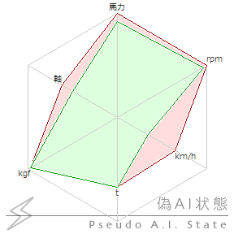

# getaistate

**カテゴリ:** ゴースト情報

AIグラフのSHIORI/3.0版。 
ゴースト内部状態(トーク数、好感度など)に関するレーダーチャートを描く。 
以下のフォーマットで返す。

グラフ表示値群 \[バイト値1\] グラフラベル群 \[バイト値1\] グラフ加算値群 \[バイト値1\] グラフ最大値群

- **グラフ表示値群**: グラフに表示したい値を半角数値・カンマ区切りで返してください。 
  2.4.26から小数点以下可。
- **グラフラベル群(省略可)**: グラフに表示したいラベルをカンマ区切りで返してください。 
  省略時：Neuron,NeuronM,NeuronK,NeuronD,NeuronE,Synapse
- **グラフ加算値群(省略可)**: グラフの「加算値」を半角数値・カンマ区切りで返してください。 
  2.4.26から小数点以下可。 
  加算値とは、学習で増えた値や、直近で変化した値などを強調表示する機能で、グラフ表示値に加算されて表示されます。 
  省略時：すべてゼロで非表示
- **グラフ最大値群(省略可)**: グラフの最大値を半角数値・カンマ区切りで返してください。最大値 ≧ (表示値 + 加算値) です。 
  2.4.26から小数点以下可。 
  省略時：表示値＋加算値を計算しその最大値をすべての要素に設定

例：1250,1500,45,65,19500,4\[b1\]馬力,rpm,km/h,t,kgf,軸\[b1\]100,50,40,0,0,1\[b1\]1350,1550,130,96,20000,8 
\[b1\]はバイト値1を示す。 
表示結果は以下の通りとなる。 

**対応:** SSP 2.4.26から小数点以下認識
