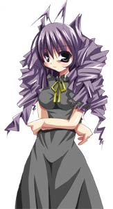
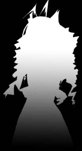
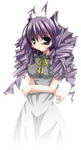

# シェル

シェルフォルダのファイルは以下の通り。

```filetree
+-(myghost)
　　+-shell
　　　　+-master
　　　　　　+-descript.txt
　　　　　　+-readme.txt
　　　　　　+-surface*.png
　　　　　　+-surface*.pna
　　　　　　+-(element).png
　　　　　　+-(element).pna
　　　　　　+-surfaces.txt
　　　　　　+-surfaces**.txt （SSPのみ）
　　　　　　+-alias.txt（旧仕様）
　　　　　　+-thumbnail.png
　　　　　　+-makoto.dll
　　　　　　+-surfacetable.txt (SSPのみ)
　　　　　　+-menu_background.png
　　　　　　+-menu_foreground.png
　　　　　　+-menu_sidebar.png
```

※menu_background.png、menu_foreground.png、menu_sidebar.pngについては「[オーナードローメニュー](owner-draw-menu.md)」のページへ。

- **[descript.txt](../descript/shell/index.md)**: シェルを識別し、基本的な設定を行うためのファイル。

  テキスト内の記載事項は[リンク先](../descript/shell/index.md)を参照。

- **readme.txt**: シェル製作者が配布元などを記載するためのもの。

  省略可能だが、用意しておくと、インストール時やベースウェアのメニューなどから参照できる。

  特にゴースト作者とシェル作者が異なるような場合には、なるべく用意される事が望ましい。

- **surface\*.png**: サーフェスファイル。

  デスクトップに表示される絵。

  画像サイズ、色数に制限は無い。

  ファイル形式はPNG[※](shell.md#シェル)。

  画像左上の1ドット(座標0,0)と同色の領域は透過色（抜き色）とされ、表示上透過される。

  サーフェスの番号は[ある程度の標準的な割り振り](../descript/shell-surfaces/surface-brace/caption_standarddef.md)があるものの、基本的には自由。

  ただし、surface0とsurface10は必須（SSPの場合推奨だが必須ではない）とされる。

  そのためたとえキャラクター一人のゴーストであっても、surface10.pngとして単色塗りつぶしの画像を用意するなどの必要がある。

  サーフェス番号はベースウェアがMATERIA（embryo、本家の伺か）なら0～8192まで。

  その他のベースウェアは制限なし。

  SSP 2.7.38以降では、surface\*.pngにアニメGIF/APNG/WebPアニメを指定すると、SERIKO定義を書かなくてもアニメーションする。

- **surface\*.pna**: サーフェスのアルファチャンネル定義ファイル。

  グレースケール（黒：透明←→不透明：白）のpng画像の拡張子部分pnaにリネームしたもの。

  サーフェス番号と同じ番号のpnaファイルを置くことによってサーフェスの半透明化ができる。

  |  | → |  | → |  |
  | --- | --- | --- | --- | --- |
  | surface0.png |  | surface0.pna |  | デスクトップの表示 |

  透過が完全でない場所は当たり判定が発生する。

  またWindows9xや非常に古いグラフィックボードなど、非対応環境ではpnaは無視される。

  なおSSPでは、[設定](../descript/shell/descript-txt/seriko.use_self_alpha.md)によりpng自体のアルファチャンネル（透明度情報）を使用するようにもできる。

- **(element).png**: [element](../descript/shell-surfaces/surface-brace/element-star.md)仕様によって、任意名のPNG画像[※](shell.md#シェル)をパーツとして合成し、一つのsurfaceとして扱う事ができる。そのためのパーツ用画像。

  ※(element)の部分を好きな名前に読み換えてよい。何枚でも使用可能で、当然なくてもよい。

  SSP 2.7.38以降では、surfaces.txtのelement定義にアニメGIF/APNG/WebPアニメを指定すると、SERIKO定義を書かなくてもアニメーションする。

  詳しくは後述の「surfaces.txt」も参照。

- **(element).pna**: 各element合成用パーツ画像ごとのpna。

- **[surfaces.txt](../descript/shell-surfaces/index.md)**: サーフェスのID割り当て、レイヤー合成、アニメーション、当たり判定などを定義するファイル。

  定義内容については[surfaces.txt](../descript/shell/index.md)参照。

  アニメーション、着せ替えについてはアニメーションを参照。

- **[surfaces\*\*.txt](../descript/shell-surfaces/index.md)**: SSP専用。

  \*\*には任意の文字列を与えてよい。

  2.01系以降でsurfaces2.txtの名前に対応し、任意の文字列がつけられるようになったのは2.2.57以降。

  機能は`surfaces.txt`と同じ。

  互換性を維持しつつSSP専用の機能を使うためのもの。

  このファイルは省略可能。必要な部分のみを追記する形でも問題ない。

- **[alias.txt](../descript/shell-surfaces/surface-alias-brace/caption_aliastxt.md)**: 旧仕様。sakura(kero).aliasブレスを記述するためのテキストファイル。

  現在はsurfaces.txtに機能が統合されている。

- **thumbnail.png**: メニューツリーでシェルの選択時に表示されるサムネイル。

  使用可能な画像形式はpngもしくはjpg。

  pngをpnrにリネームすると画像左上の1ドット(座標0,0)と同色が透過される。

  このファイルは省略可能。

- **[makoto.dll](translator.md)**: トランスレート機能を使うためのもの。

  [ゴースト側](ghost.md)に用意できるものと同じ。詳しくは[リンク先](translator.md)を参照。

  このファイルは省略可能。

- **[surfacetable.txt](../descript/shell-surfacetable/index.md)**: SSP専用。

  SSP開発用パレットの「サーフィステスト」機能や、そのほかのシェル作成支援ユーティリティでの利用を目的としたサーフェス内容の定義ファイル。

  詳しくは[リンク先](../descript/shell-surfacetable/index.md)を参照。

  このファイルは省略可能。

!!! tip "ヒント"

    - **[※1](shell.md#シェル),[※2](shell.md#シェル)**: SSPでは暗号化PNG(DAP/DDP/DFP/DGP)・GIF（非アニメ）・JPEG・BMPも使用可能だが、*非推奨*。

      過去互換の為読み込みは可能だが、今後追加される機能や仕様についてPNG以外の形式がサポートされる保証はない。

      また現時点でも、PNG以外の全形式で透明度仕様（pnaおよび[seriko.use_self_alpha](../descript/shell/descript-txt/seriko.use_self_alpha.md)）が利用不可であるし、JPEGについては圧縮によって色がずれやすいため透過色と相性が悪いという弊害もある。
