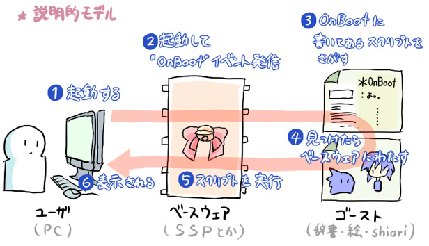
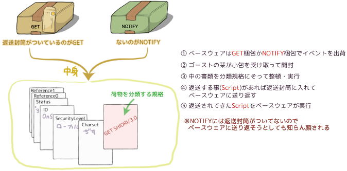

# 補足: SHIORI Eventとは

## このページについて

このページでは、「SHIORI Event」について概説しています。

以下の記事はSHIORI/3.0のきちんとした仕様書*ではなく*、その考え方を理解するための大まかな手引きにすぎません。

なお個々のSHIORI Eventについての解説は、「[SHIORI Event](../list/shiori-event/index.md)」のページにある一覧から参照してください。

## 目次

- [SHIORI Event（栞イベント）とは](shiori-event.md#shiori-event栞イベントとは)
- [Reference（リファレンス）](shiori-event.md#referenceリファレンス)
- [GETコマンドとNOTIFYコマンド](shiori-event.md#getコマンドとnotifyコマンド)

## SHIORI Event（栞イベント）とは

*起動からゴーストが動くまで*

そもそもゴーストが動く（喋る、表情を変える、etc.）とはどういうことでしょうか。

大雑把に言えば、それは*ベースウェア*（MATERIA、CROW、SSPなど）と*SHIORI*（ゴーストのコアとなる部品）の連携によって実現される機能です。

SHIORI Eventは、その現場においてベースウェアとSHIORIがそれぞれどんな役割を果たしているのか、その中身を理解するための重要なキーワードになります。

ゴーストの動作において、最初に働くのはベースウェアです。

ベースウェアが第一に果たす大きな仕事は、*ゴーストが喋ったり動いたりするタイミング*を作る事です。

べースウェアは時間やマウス入力などの様々な状態を監視し、特定の変化（例えば１秒や１分と言う時間の経過、あるいはマウスカーソルがゴーストに触れた、など）をきっかけにして、ゴースト（のコアであるSHIORI）に対して知らせを発行します。

この知らせの事を、*SHIORI Event*と呼んでいます。

一方のSHIORIの仕事はここから始まります。SHIORIはSHIORI Eventを受け取ると、自らの辞書と呼ばれるファイルの内容を利用するなどして、*ゴーストの動作指示を作ります*（この動作指示の事をさくらスクリプトと言います）。

そしてSHIORIがその動作指示を*ベースウェアに送り返す*と、それを受け取ったベースウェアは動作指示の内容を読み取って、ゴーストの動きを表現することになります。

このようにして、ゴーストはSHIORI Eventがおきるたびに、実際にユーザのモニタの中で動いているのです。

また逆に言えば、*SHIORIはSHIORI Eventを受け取るまでゴーストを動かすことはできません*。原則としてあらゆるゴーストの動作はSHIORI Eventにおいて行われるもので、受動的なものなのです。

例え一見そのように見えなくとも、例えば多くのゴーストが備える「ランダムトーク」「AIトーク」と呼ばれる機能は、多くのSHIORIではそれを、毎秒発行される[OnSecondChange](../list/shiori-event/time/OnSecondChange.md)の処理において実装している事に注意してください（このあたりはあくまでSHIORIごとの実装なので、詳細はSHIORIごとのドキュメントを参照する必要があります）。

## Reference（リファレンス）

多くのSHIORI Eventでは、SHIORI EventのID（名前・種類）と共に、関連する情報が*Reference*という形で通知されます。

一例として、ゴーストがクリックされた時に発行される[OnMouseClick](../list/shiori-event/mouse/OnMouseClick.md)というIDの場合を見てみると、どのスコープ（本体側、相方側、三人目...）がクリックされたのか、そのスコープのどの当たり判定がクリックされたのか、どのボタン（右、左、ホイール...）でクリックされたのか、といった情報がReferenceとして通知されています。

例えばSHIORIは、Referenceをゴーストの動きに変化をつけることに使えるでしょう。

OnMouseClickの例で言うならば、多くのゴーストはどのスコープのどの部位をクリックされたかに応じて、実行する機能やトークを変化させています。

*全てのReferenceには0から始まる通し番号が与えられ*、同じIDのSHIORI Eventが持つReferenceは、基本的に*常に同じ番号に同じ内容が対応する*ようになっています。

このことは、[SHIORI Eventの一覧ページ](../list/shiori-event/index.md)の各IDの節にある、IDに伴って通知されるReferenceのリストを見れば解りやすいかもしれません。

しかしIDによっては、Referenceの数が不定の場合もあります。

例えばSHIORI Eventの一覧ページで、[installedghostname](../list/shiori-event/notify/installedghostname.md)と言うSHIORI EventのReferenceをみると、「Reference\*」といった形で番号が明記されていません。

installedghostnameは、起動直後などに発生し、そのベースウェアにインストールされているゴースト名を全て教えてくれるSHIORI Eventです。インストールされているゴースト数は当然ユーザによってまちまちですから、従ってReferenceも不定数となっているのです。

Referenceの総数が不定であっても、全てのReferenceは0から始まる通し番号付きで表されるという原則は変わりません。

## GETコマンドとNOTIFYコマンド

*SHIORI Eventを郵便に例えるなら……*

実は全てのSHIORI Eventは、IDが様々あるだけではなく、発行自体に二つの異なった形・目的があります。

一つが、ここまででも述べてきた、ゴーストの動くタイミングとしてのSHIORI Eventの発行です。

これは*GETコマンド*と呼ばれ、その名の通りベースウェアがSHIORIから動作指示（さくらスクリプト）などの内容を受け取る（get）ためのSHIORI Eventの発行です。

もう一つの*NOTIFY（ノーティファイ）コマンド*は少し特殊で、NOTIFYコマンドで発行されたSHIORI Eventでは、ゴーストは動く事ができません。

なぜなら、NOTIFYコマンドのSHIORI Eventに対してSHIORIが何かの動作指示を送り返したとしても、ベースウェアはこれを無視することになっているからです。

NOTIFYコマンドの目的は、SHIORIに対して情報（Reference）を知らせる（notify）ことにあります。

SHIORIは受け取った情報をそのSHIORI Eventで使うというよりは、今後のゴーストの動作のために役立てる事ができます。

先述の[installedghostname](../list/shiori-event/notify/installedghostname.md)は、NOTIFYコマンドで発行されるIDの典型です。SHIORIはそのReferenceから、ユーザの環境にどんなゴーストがインストールされているかを知る事ができます。ゴーストはその情報を元に、例えば「特定のゴーストがインストールされているなら、そのゴーストを呼び出すための項目をメニューに表示する」といった仕掛けを作る事ができるでしょう。

注意を要する点ですが、二つのコマンドの存在は、SHIORI EventのID全体が二つの「グループ」に分けられる*ということを意味しません*。

何故なら、原則として*全てのIDのSHIORI EventがNOTIFY、GETのいずれでも発行される*可能性があるからです。コマンドの種類とIDの種類はあくまでも独立したもので、本質的には依存関係にありません（しかしながら現実の実装を眺めてみたときには、一定の傾向や規則が認められます。そうした詳細については[SHIORI Eventの一覧ページ](../list/shiori-event/index.md)のそれぞれの節を参照してください）。
